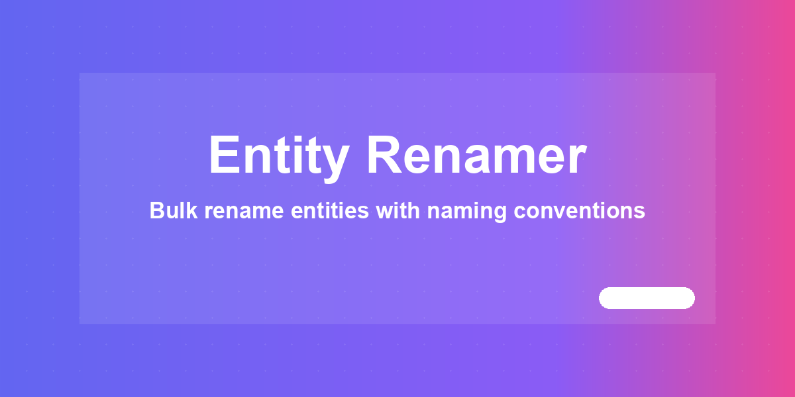
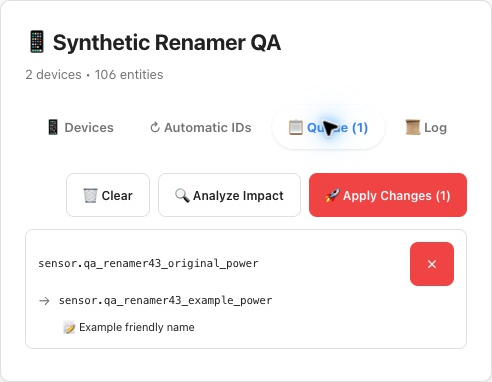
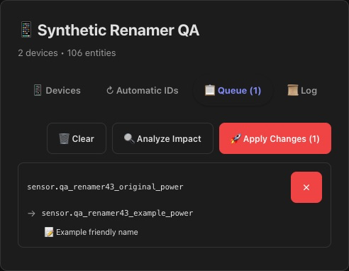
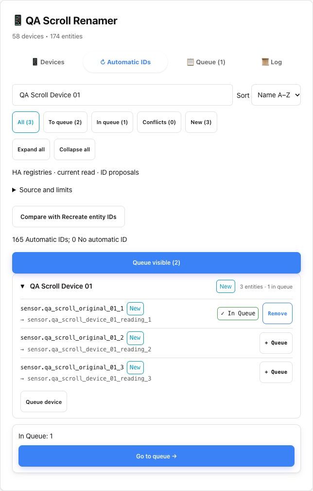

# Entity Renamer



Bulk-rename Home Assistant devices and entities — `entity_id`, friendly names,
or a whole device's entities at once by prefix — with an impact preview for
references visible through Home Assistant's APIs.

[](https://github.com/MacSiem/ha-entity-renamer/releases) [](LICENSE)

## How it works

1. **Devices and entities from the registries.** On load, the card fetches
   every device (`config/device_registry/list`) and entity
   (`config/entity_registry/list`), groups entities under their parent
   device, and lets you search across both.
2. **Queue renames without touching anything yet.** Expand a device to add an
   entity to the queue with a new `entity_id` and/or a new friendly name
   using the inline form (**Add to queue** or **Cancel**, Enter or Escape),
   rename the device's display name, or use **Change prefix** to bulk-rename
   every entity under a device that shares a common `object_id` prefix (e.g.
   `sensor.old_*` → `sensor.new_*`).
   The **Automatic IDs** tab calls the same Home Assistant command as
   **Recreate entity IDs**, shows proposed changes grouped by device, and
   lets you queue one entity, one device or all eligible rows. HA chooses the
   names using its current language and entity ID format. Rows with no
   automatic ID or a target collision are shown but cannot be queued.
   Devices are sorted by their displayed name. Queuing keeps this tab and
   expanded device groups open; queued entries are marked **In Queue**.
   Remove a proposal in **Queue** to make it available for queuing again.
3. **Analyze impact before applying.** The Queue tab's **Analyze Impact**
   button calls `search/related` for each queued entity to list the
   automations, scripts, and scenes that reference it, then scans every
   Lovelace dashboard (`lovelace/dashboards/list` + `lovelace/config`) for raw
   references where those resources are readable. You may still need to check
   YAML, templates and other references manually.
4. **Apply with confirmation.** **Apply Changes** shows a confirmation
   dialog, then writes the changes via `config/entity_registry/update`
   (entity_id and/or name) and `config/device_registry/update` (device
   display name), and logs every attempt — success or failure — to the Log
   tab. ID and friendly name are sent in one update per entity. Successful
   items leave the queue; failed items remain available for review and retry.
   The confirmed queue is frozen while it runs. A change of account, role or
   connection or browser availability cancels any remaining writes and requires
   a fresh confirmation. A sent request with no verified readback remains unknown
   in its originating administrator’s local history. Reconnecting does not restore
   an earlier confirmation. Permitted registry browsing reloads for the newly
   recognized account or role after any old operation has finished.
   Automatic proposals are checked against the current registry and
   regenerated IDs again immediately before applying. Stale proposals fail
   without a registry write and remain in the queue for review.

### What is automatic vs. manual

| Automatic | Manual (optional) |
|---|---|
| Loading every device and entity from the registries | Choosing which entities/devices to queue |
| Impact scan across automations, scripts, scenes, dashboards | Editing the automations/scripts/dashboards a rename affects — the card does not rewrite YAML or Lovelace config for you |
| Rename confirmation dialog before any registry write | Bulk prefix rename — you choose the old/new prefix per device |
| Rename history log kept in your browser | Checking integrations and references after an `entity_id` change |
| Read-only automatic ID preview | Choosing which proposed changes to queue and confirming writes |

## Screenshots

| Light | Dark |
|---|---|
|  |  |

*A queued synthetic entity-ID and friendly-name change, before confirmation
or any registry write. Use Analyze Impact to review readable references.
Dark mode follows your Home Assistant theme.*

## Installation

Requires **Home Assistant 2025.6 or newer** for the automatic ID preview.

1. Open HACS and search for **Entity Renamer** in the **Dashboard** category.
2. Download the latest release and reload your browser.
3. Add a manual card using the configuration below.

If the repository is unavailable in your HACS catalogue, add
`https://github.com/MacSiem/ha-entity-renamer` as a custom repository in
category **Dashboard** (Lovelace plugin).

## Quick start

```yaml
type: custom:ha-entity-renamer
```

That's it — no options are required. An optional **Title** field is
available in the card's visual editor.

## Features

- **Device & entity browser** — search across devices and entities, grouped
  by device.
- **Entity rename** — change `entity_id` (object_id), friendly name, or both,
  per entity.
- **Device rename** — rename a device's display name.
- **Bulk prefix rename** — rename every entity under a device that shares a
  common `object_id` prefix in one action.
- **Recreate entity IDs preview** — compare with HA's own automatic ID
  calculation, queue per entity/device/all, and reject stale or colliding IDs.
- **Impact analysis** — inspect references that HA's related search and
  readable dashboards expose before you rename.
- **Rename history** — recorded attempts and independently verified outcomes, kept
  in this browser for the originating administrator. An ACK alone stays unconfirmed.
- **Export completed history** — JSON, CSV or TXT with the exact file preview and
  a filename before download. The default uses paired pseudonyms; explicitly opt in
  to strict old/new entity IDs for your private mapping. Names, raw errors, accounts,
  addresses, tokens and configuration are excluded. Recorded reference counts keep
  missing data distinct from zero and disclose partial dashboard coverage.

## FAQ

**Does this rename entities immediately when I add them to the queue?**
No. Adding an entity or device to the queue only stages the change — nothing
is written to Home Assistant until you click **Apply Changes** and confirm.

**Will this update my automations and dashboards automatically?**
No. The card shows you which automations, scripts, scenes, and dashboards
reference a renamed entity so you know what to fix, but it does not rewrite
that YAML or Lovelace config for you.

**Do I need to restart Home Assistant after a rename?**
A successful registry update takes effect without a routine Core restart.
Review the affected references and check the integration after an ID change;
follow that integration's instructions if it needs a reload.

**Does this send data anywhere?**
No. Everything runs locally in your browser against your Home Assistant
instance — no telemetry, no analytics, no CDN-hosted assets. The only
external link in the card is the optional Buy Me a Coffee support link,
which only loads anything if you click it.

## Changelog

See [CHANGELOG.md](CHANGELOG.md).

## Support

- [Buy Me a Coffee](https://buymeacoffee.com/macsiem)
- [PayPal](https://www.paypal.com/donate/?hosted_button_id=Y967H4PLRBN8W)

The optional in-card support link is shown only to administrators. Dismiss it in the card or set `show_support: false` in the card configuration.

## License

MIT, see [LICENSE](LICENSE).

## Privacy and data

The card reads entity/device registries and configuration references to preview changes to entity IDs. Applying a confirmed queue changes Home Assistant registry IDs; related configuration references need separate review. Keep impact reports and rollback mappings private. Rename history and dismissed
intro/support preferences use browser local storage for this Home Assistant
origin. New rename history persists across reloads in a separate namespace for
its administrator account and origin. Changing account or authority clears the
previous account’s private results, drafts and history from the card. Resolved
household users retain registry browsing allowed by Home Assistant; applying
changes and reviewing/exporting private history require an administrator.

Older unscoped history remains untouched. An administrator can explicitly choose
**Review legacy history from this browser**. Its account origin remains unknown,
and reviewing/exporting it does not assign it to the current account or overwrite
the original storage. This choice clears when authority changes. Preferences
remain shared by cards on this origin. Signing out of Home Assistant clears this
origin’s browser storage, including locally kept Renamer history and legacy entries.
Export a copy before signing out. History is not synchronized to other devices;
use separate browser profiles on a shared computer. Queued proposals stay in memory
and are lost on a page reload. Where the browser supports Save As, choose a location
and keep the reviewed filename. Saved appears only after closing the file and
reading back identical bytes. Cancelling or changing that filename leaves the
outcome unconfirmed. Other browsers use the existing download, whose initiation
does not confirm a disk write; check the downloaded file before trying again.

See [SECURITY.md](SECURITY.md) for safe vulnerability reporting and [NOTICE](NOTICE) for licensing notices.

### Finding proposals in large registries

Devices and Automatic IDs share natural name sorting in the Home Assistant language. Use the search and counted filters **All**, **To queue**, **In queue**, **Conflicts** and **New**. Conflicts refer to the current Automatic IDs comparison; run the comparison to discover them. Changing a filter does not change the queue. **Queue visible (N)** and per-device actions add only the visible matching eligible proposals.

**New** means created in the Home Assistant registry within the last seven days; migrated entries with an unknown creation time are not marked. Choose **Newest** or **Name A–Z / Z–A** and expand or collapse groups.

The queue groups proposals by device and shows their source: Automatic IDs, Manual or Prefix. Removing one proposal offers **Undo** for eight seconds and restores the same proposal at its original position. Clear, opening confirmation, disconnecting or changing accounts cancels undo. The queue bar also includes queued device-name changes. Applying changes retains the existing administrator permission, impact review and explicit confirmation.

#### Automatic IDs preview

The screenshots below show synthetic devices on Home Assistant, with four local proposals and no registry writes. The search matches two devices; queued counts remain visible when a group is collapsed.

<picture>
  <source media="(prefers-color-scheme: dark)" srcset="docs/screenshots/card-automatic-dark.png">
  
</picture>

History dates use the browser/system time zone by default and respect explicit Home Assistant profile choices for local/server time, date language and 12/24-hour format. Open history refreshes when those preferences change. Full ISO timestamps and the displayed time zone remain under **Time details**; legacy entries that only stored a time are explicitly marked **date unknown**. **Source and limits** retains the complete explanation and can be opened with the keyboard.
