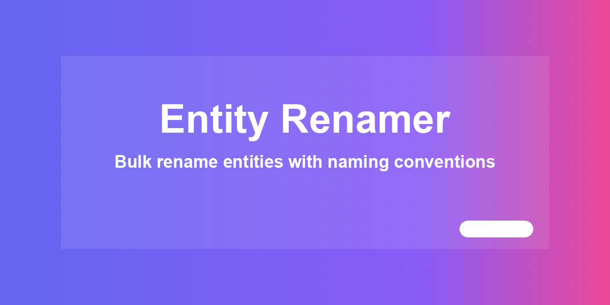
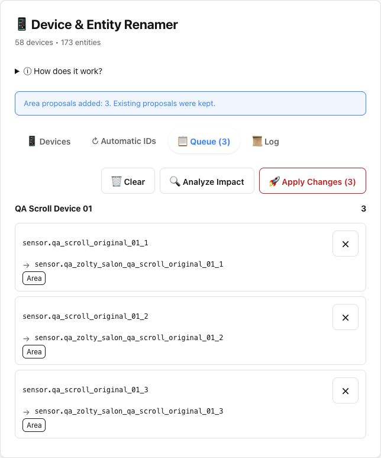
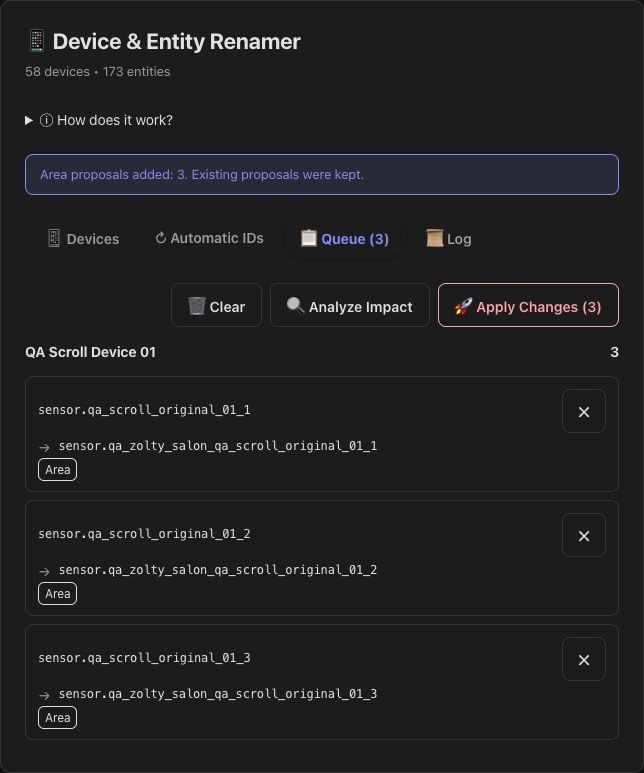
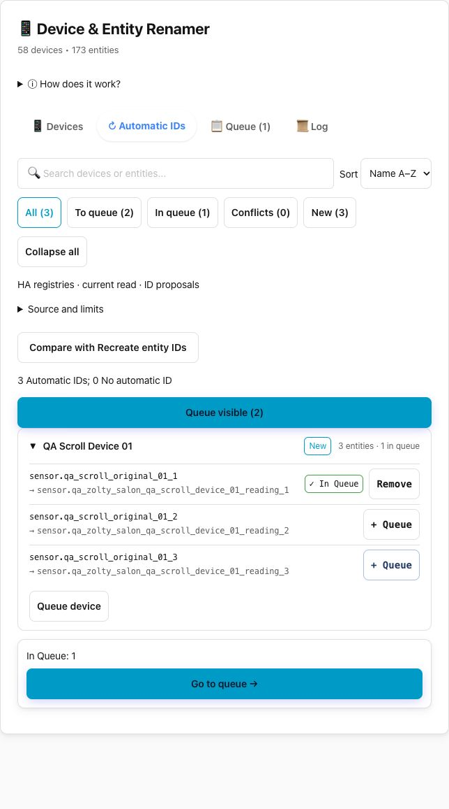

# Entity Renamer



Bulk-rename Home Assistant devices and entities — `entity_id`, friendly names,
or a whole device's entities at once by prefix — with an impact preview for
references visible through Home Assistant's APIs.

> **Unreleased candidate:** This branch describes development after public
> 4.6.1. Its dependency migration and recovery use a companion backend that
> is not included in the published 4.6.1 frontend release. Distribution and
> installation of the candidate companion are still being prepared; this branch
> is not an installation or release announcement.

[](https://github.com/MacSiem/ha-entity-renamer/releases) [](LICENSE)

## Public release 4.6.1

The published 4.6.1 dashboard plugin browses the registries, queues entity and
device renames and writes confirmed changes through Home Assistant's registry
APIs. Its dependency options are disabled and marked **Coming soon**; it does
not automatically rewrite YAML or dashboard references and does not include a
companion integration. Review and update affected references separately.
The installation steps below are for this public release.

## How the unreleased candidate works

1. **Devices and entities from the registries.** On load, the card fetches
   every device (`config/device_registry/list`) and entity
   (`config/entity_registry/list`), groups entities under their parent
   device, and lets you search across both.
2. **Queue renames without touching anything yet.** Expand a device to add an
   entity to the queue with a new `entity_id` and/or a new friendly name
   using the inline form (**Add to queue** or **Cancel**, Enter or Escape),
   rename the device's display name, or use **Change prefix** to bulk-rename
   every entity under a device that shares a common `object_id` prefix (e.g.
   `sensor.old_*` → `sensor.new_*`).
   The **Automatic IDs** tab calls the same Home Assistant command as
   **Recreate entity IDs**, shows proposed changes grouped by device, and
   lets you queue one entity, one device or all eligible rows. HA chooses the
   names using its current language and entity ID format. Rows with no
   automatic ID or a target collision are shown but cannot be queued.
   Devices are sorted by their displayed name. Queuing keeps this tab and
   expanded device groups open; queued entries are marked **In Queue**.
   Remove a proposal in **Queue** to make it available for queuing again.
3. **Analyze impact before applying.** The Queue tab's **Analyze Impact**
   button calls `search/related` for each queued entity to list the
   automations, scripts, and scenes that reference it, then scans every
   Lovelace dashboard (`lovelace/dashboards/list` + `lovelace/config`) for raw
   references where those resources are readable. You may still need to check
   YAML, templates and other references manually.
4. **Review the server plan.** In this candidate, **Apply Changes** opens a
   confirmation from which **Prepare review** creates a server-owned review of
   the selected registry changes and recognized dependencies. Review every listed change, coverage limitation
   and conflict. Preparing and previewing do not apply the plan.
5. **Decide before writing.** Before applying, the card recommends a full
   Home Assistant backup and warns that a required reload may interrupt running
   automations and scripts. Cancel or Escape keeps the queue and sends no apply.
   Continue submits the reviewed operation once. A changed account, role,
   connection or expired review requires a new review; an old confirmation is
   not reused. Do not assume a change of authority can interrupt a native effect
   already in progress: check the outcome rather than repeating it.
6. **Wait and check the outcome.** Apply, inspection and restore can take
   several minutes depending on the instance and data; no duration is
   guaranteed. The journal reports observed steps, not a percentage or proof
   of completion. Check the separate inspection and registry results. If an
   outcome is unknown, do not repeat the write. Use **Find previous operations**
   and **Check status and inspect**; restore is offered only after a fresh
   inspection admits the exact scope and you separately review and confirm it.
   An unsupported or uncertain state may remain unavailable for restore.

## Scope and limitations of the candidate

The reviewed flow covers selected entity/device registry changes and recognized
references, including qualified Template, Automation, Script, dashboard,
helper, integration and Powercalc/Energy cases. Coverage is determined for the
particular plan, not for an entire integration family. Unsupported or dynamic
cases that cannot be safely admitted are refused; the review also identifies
scan limitations. Custom or external consumers may not be discoverable, so
check them separately. Tests cover multiple Home Assistant versions and
instances with different data; they cannot guarantee every configuration.

The candidate protects the observed history, statistics, identity and numeric
values during admitted changes and verifies the affected scope. This is not a
claim that every possible setup or interrupted operation can be restored.
For Powercalc 1.26.1, Home Assistant 2025.6 is unsupported; Powercalc itself
requires 2026.4 or newer. Other candidate components have their own supported
version checks. With native precision 2, ordinary Powercalc reload may round
its displayed/restored value; do not assume lossless precision beyond native
behavior. Keep the full backup and verify the actual result.

| Automatic | Your review |
|---|---|
| Load registries and prepare proposals | Choose changes and inspect the plan and coverage limits |
| Check recognized dependencies and validate the reviewed operation | Check undiscovered external or custom references |
| Show observed progress and independent inspection | Decide whether an admitted restore should be performed |

## Screenshots

These historical images show the queue workflow from 4.5.0. They do not
show the unreleased candidate's server review or recovery screens.

| Light | Dark |
|---|---|
|  |  |

*Three synthetic area-prefix proposals in the queue, before confirmation
or any registry write. Use Analyze Impact to review readable references.
Dark mode follows your Home Assistant theme.*

## Installation of public 4.6.1

The following instructions describe the released frontend, not this branch's unreleased companion-backed candidate. Candidate distribution and migration's exact steps will be documented after its installation path is qualified.

Requires **Home Assistant 2025.6 or newer** for the automatic ID preview.

1. Open HACS and search for **Entity Renamer** in the **Dashboard** category.
2. Download the latest release and reload your browser.
3. Open your dashboard, choose **Edit dashboard → Add card → By card**, and search for **Entity Renamer**.
4. Select the card, review its live preview and choose **Save**. No YAML or entity selection is required.

If the repository is unavailable in your HACS catalogue, add
`https://github.com/MacSiem/ha-entity-renamer` as a custom repository in
category **Dashboard** (Lovelace plugin).

## Quick start

The card picker opens the visual editor with working defaults. Optional YAML configuration:

```yaml
type: custom:ha-entity-renamer
```

That's it — no options are required. The visual editor also offers a title, tab selection and help/support preferences.

## Card options

All options below are available in the visual editor. Additional YAML fields are retained when editing.

| Option | Default | Behavior |
| --- | --- | --- |
| `title` | Localized tool title | Custom heading; empty uses the default. |
| `default_tab` | `devices` | Initial view: `devices`, `automatic`, `queue` or `log`. Must be included in `tabs`. |
| `tabs` | All four | Visible views in the standard order. An empty/invalid list falls back to all views. Internal queue/history flows can reveal their required view. |
| `show_help` | `true` | Collapsible instructions. Starts collapsed below 500 px; closing is remembered for the current HA account in this browser. |
| `show_support` | `true` | Optional administrator support link; existing dismissal is respected. |

```yaml
type: custom:ha-entity-renamer
default_tab: devices
tabs: [devices, automatic, queue, log]
show_help: true
show_support: false
```

Selecting **Queue area prefixes** in a device's details adds proposals such as `sensor.salon_temperature` for review. An entity's area takes precedence over its device's area. Unknown areas and names that cannot form a valid prefix produce no proposal; an existing prefix is not repeated. Existing queued proposals are retained. Area names are converted to lowercase ASCII identifier segments. This action only reads the area registry and prepares drafts; it does not rename entities.

## Features

- **Device & entity browser** — search across devices and entities, grouped
  by device.
- **Entity rename** — change `entity_id` (object_id), friendly name, or both,
  per entity.
- **Device rename** — rename a device's display name.
- **Bulk prefix rename** — rename every entity under a device that shares a
  common `object_id` prefix in one action.
- **Recreate entity IDs preview** — compare with HA's own automatic ID
  calculation, queue per entity/device/all, and reject stale or colliding IDs.
- **Impact analysis** — inspect references that HA's related search and
  readable dashboards expose before you rename.
- **Rename history** — recorded attempts and independently verified outcomes, kept
  in this browser for the originating administrator. An ACK alone stays unconfirmed.
- **Export completed history** — JSON, CSV or TXT with the exact file preview and
  a filename before download. The default uses paired pseudonyms; explicitly opt in
  to strict old/new entity IDs for your private mapping. Names, raw errors, accounts,
  addresses, tokens and configuration are excluded. Recorded reference counts keep
  missing data distinct from zero and disclose partial dashboard coverage.

## FAQ

**Does this rename entities immediately when I add them to the queue?**
No. Adding an entity or device to the queue only stages a proposal in the card.
Preparing a review can store preparation data on Home Assistant; it does not
apply the selected rename.

**Will this update my automations and dashboards automatically?**
The unreleased candidate can update admitted references in the reviewed plan.
It does not claim to discover or update every external or custom reference.
The public 4.6.1 release does not automatically migrate dependencies.

**Do I need to restart Home Assistant after a rename?**
A plan may require an integration reload. A reload can interrupt running
automations or scripts; inspect the plan and check the affected behavior afterward.
A routine Core restart is not implied by every rename.

**Does this send data anywhere?**
The card communicates with your Home Assistant instance, and the candidate
backend reads and writes local Home Assistant data as described below. The
card does not automatically submit an issue report; the GitHub issue and
optional support links open external sites only when selected. Review exports
before sharing them, and never include private configuration or credentials
in a public issue.

## Changelog

See [CHANGELOG.md](CHANGELOG.md).

## Support

- [Buy Me a Coffee](https://buymeacoffee.com/macsiem)
- [PayPal](https://www.paypal.com/donate/?hosted_button_id=Y967H4PLRBN8W)

The optional in-card support link is shown only to administrators. Dismiss it in the card or set `show_support: false` in the card configuration.

## License

MIT, see [LICENSE](LICENSE).

## Privacy and data

The card reads entity and device registries and available references. The
candidate backend also reads relevant local configuration, registry, dependency,
state and history data to prepare and verify a plan; an admitted operation can
write affected registries and configuration. It keeps server-side preparations,
operation journals and receipts in Home Assistant storage for verification and
recovery. Those records and normal Home Assistant logs can contain identifiers,
paths or other sensitive information: protect your backups, logs and HA storage.
The backend can also keep local YAML before-images under
`.storage/ha_entity_renamer_backups` for its transaction, which are not a full
Home Assistant backup. It also stages file changes under
`.storage/ha_entity_renamer_pending`. Validation stages copies outside the HA configuration
directory in a private temporary directory; these copies can contain secrets.
Normal cleanup removes the temporary directory, but an interruption or crash
may leave it behind. Protect and check the host's temporary storage as well.
The server review is time-limited; an uncertain outcome must not be retried.

Rename history and help/support preferences are stored in this browser for the
Home Assistant origin. New history is scoped to the administrator account;
changing authority removes the prior account's results from the current card,
but does not imply that all stored data has been deleted. Older unscoped history
can be reviewed explicitly, with its account origin unknown. History is not
synchronized between browser profiles. Queued proposals are held in memory.

Completed history can be exported as JSON, CSV or TXT. The default uses paired
pseudonyms; an explicit option includes old/new entity IDs. Preview the file and
keep exports private. Where supported, Save As is confirmed only after a
readback of identical bytes; a browser download initiation alone does not prove
that a file was saved. The warning dialog does not create or verify a full
Home Assistant backup or submit an issue report.

See [SECURITY.md](SECURITY.md) for safe vulnerability reporting and [NOTICE](NOTICE) for licensing notices.

### Finding proposals in large registries

Devices and Automatic IDs share natural name sorting in the Home Assistant language. Use the search and counted filters **All**, **To queue**, **In queue**, **Conflicts** and **New**. Conflicts refer to the current Automatic IDs comparison; run the comparison to discover them. Changing a filter does not change the queue. **Queue visible (N)** and per-device actions add only the visible matching eligible proposals.

Adding or removing proposals keeps the list position, expanded groups and keyboard focus. Queued status is text beside a single **Remove** action. Devices and Automatic IDs share the same headers and entity counts.

**New** means created in the Home Assistant registry within the last seven days; migrated entries with an unknown creation time are not marked. Choose **Newest** or **Name A–Z / Z–A** and expand or collapse groups.

The queue groups proposals by device and shows their source: Automatic IDs, Manual, Prefix or Area. Removing one proposal offers **Undo** for eight seconds and restores the same proposal at its original position. **Clear** replaces any individual undo with an eight-second undo for the cleared batch, including device-name drafts; newer proposals take precedence when restoring. Opening confirmation, disconnecting or changing accounts cancels undo. The queue bar also includes queued device-name changes. Applying changes retains the existing administrator permission, impact review and explicit confirmation.

#### Automatic IDs preview

The screenshots below show a synthetic Home Assistant fixture. The comparison shows three entities on one QA device, with one queued proposal and no registry writes. Queued entities show a text status and one Remove action.

<picture>
  <source media="(prefers-color-scheme: dark)" srcset="docs/screenshots/card-automatic-dark.jpg">
  
</picture>

History dates use the browser/system time zone by default and respect explicit Home Assistant profile choices for local/server time, date language and 12/24-hour format. Open history refreshes when those preferences change. Full ISO timestamps and the displayed time zone remain under **Time details**; legacy entries that only stored a time are explicitly marked **date unknown**. **Source and limits** retains the complete explanation and can be opened with the keyboard.
